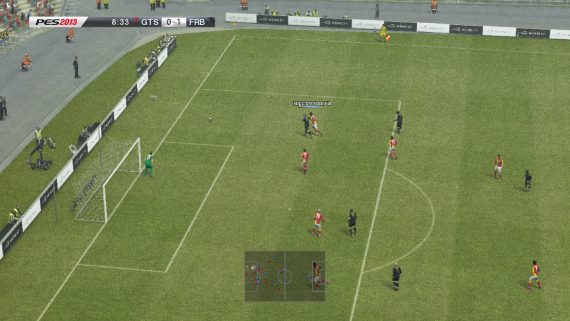
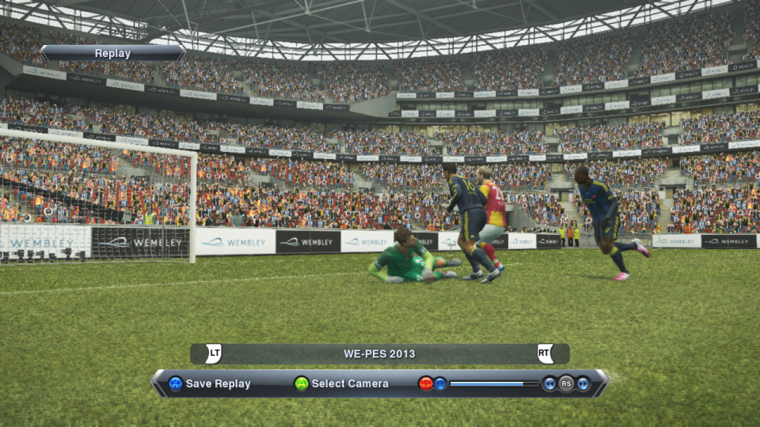
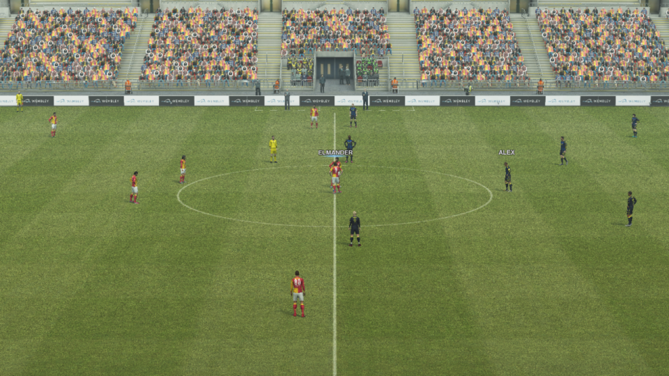
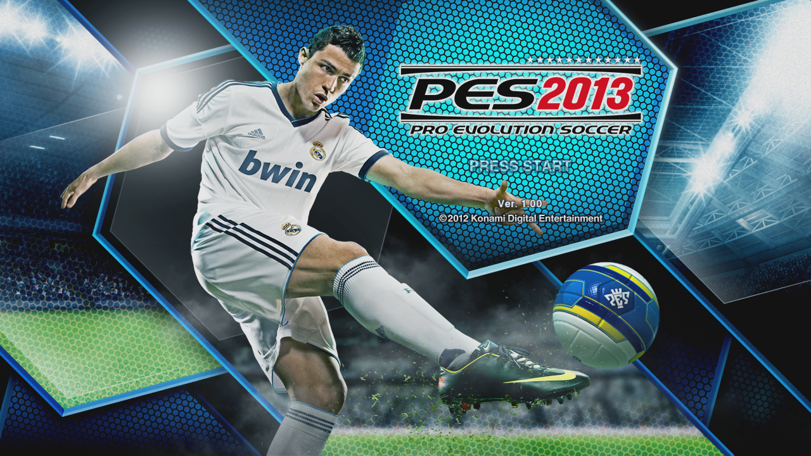

<h1 align="center">PES13Recomp</h1>

<p align="center">
  <b>An unofficial native port of Pro Evolution Soccer 2013 (Xbox 360), built by static recompilation, for Windows and iPad.</b>
</p>

<p align="center">
  
  
  
  
  
  
</p>

<p align="center">
  
  
  
  
</p>
<p align="center"><sub>Running natively on Windows (Vulkan). Screenshots from the author's own copy of the game.</sub></p>

> [!IMPORTANT]
> **You must own the game.** This repository contains no game code, data or assets, and no
> builds of the game are distributed. You build it yourself from your own dump of the PES 2013
> Xbox 360 disc (Europe). Pro Evolution Soccer 2013 belongs to Konami; this project is not
> affiliated with Konami or Microsoft.

> [!WARNING]
> **Work in progress.** It is playable on Windows (menus, training, exhibition matches, sound,
> saves), but expect bugs. The iPad version builds but has not yet run on a device.

## Contents

- [Features](#features)
- [Status](#status)
- [Building and playing on Windows](#building-and-playing-on-windows)
- [iPad](#ipad)
- [Controls](#controls)
- [Files and folders](#files-and-folders)
- [Reporting a problem](#reporting-a-problem)
- [How it works](#how-it-works)
- [Credits](#credits)
- [License](#license)

## Features

| | |
|---|---|
| **60 fps** | Matches run at a locked 60 fps on Windows; set pieces and goal kicks are locked to 30 fps by the game itself |
| **Native code** | All ~67,000 PowerPC functions of the game are translated ahead of time to C++, so there is no emulator and no JIT. iPadOS forbids JIT. |
| **Vulkan renderer** | Renders at the GPU command-processor level, with a model of the Xbox 360's EDRAM. Xenos shaders are translated to SPIR-V on first use and cached. |
| **iPad** | Uses the same renderer, running on Metal through MoltenVK |
| **Aspect ratio** | Keeps the game's 16:9 picture on any window or screen shape (letterbox / pillarbox) |
| **Sound** | XAudio implemented on miniaudio |
| **Saves and profiles** | Profiles, save data, notifications and the Xbox on-screen keyboard (player names) work |
| **Controllers** | Xbox, PlayStation and MFi controllers via SDL / XInput, plus a keyboard |

## Status

| Milestone | State |
|---|---|
| Recompiled code compiles | ✅ Done |
| Boots on Windows | ✅ Done |
| Graphics | ✅ Menus, training, matches and cutscenes render correctly |
| Menus, input, matches | ✅ Windows: training, exhibition matches, sound, saves (60 fps; set pieces and goal kicks locked to 30 fps by the game) |
| iPad | 🚧 The app builds; not yet run on a device |
| Polish | 📋 Planned: anisotropic filtering, FXAA, resolution scaling, touch controls ([docs/improvements.md](docs/improvements.md)) |

Open bugs are tracked in [docs/listofbugs.md](docs/listofbugs.md).

## Building and playing on Windows

**Requirements:** Visual Studio 2022 with the **C++ Clang tools** (clang-cl and lld; the recompiled
code needs Clang), CMake ≥ 3.20, Ninja and PowerShell. The Vulkan SDK is optional (validation layers).
You also need a GPU with Vulkan support and about 16 GB of RAM for the build.

1. **Clone** with submodules:

   ```bat
   git clone --recursive https://github.com/xamphy/PES13Recomp.git
   cd PES13Recomp
   ```

2. **Dump your disc.** Make an ISO of your own PES 2013 disc (Europe), then extract it with the
   bundled extract-xiso:

   ```bat
   tools\extract-xiso\artifacts\extract-xiso.exe -d game\files "PES 2013.iso"
   copy game\files\default.xex game\xex\default.xex
   ```

3. **Recompile the game code** into `generated/`. This takes a few minutes.

   ```bat
   tools\build-xenonrecomp.bat
   powershell -ExecutionPolicy Bypass -File tools\recomp.ps1
   ```

4. **Build** the runtime and the recompiled code. The first build takes a while (~430 large files).

   ```bat
   tools\build-runtime.bat          :: -> build\Release\bin\pes13.exe
   ```

5. **Play:**

   ```bat
   build\Release\bin\pes13.exe --run
   ```

The first launch is slower while shaders are translated. After that they are cached in `userdata/`.

## iPad

The iPadOS app is built on macOS, either on a Mac or on a macOS runner in your own **private**
repository. Because it contains code recompiled from the game, the `.ipa` is never published here.
Installing it from a Windows PC with AltStore, and copying the game files, is described in
[docs/IPAD.md](docs/IPAD.md).

The app asks for the `extended-virtual-addressing` and `increased-memory-limit` entitlements. The
Xbox 360 address space is 4 GB, and a match uses about 1 GB.

## Controls

A controller is recommended. Keyboard controls (player 1, Windows):

| Xbox 360 | Keyboard | | Xbox 360 | Keyboard |
|---|---|---|---|---|
| Left stick | W A S D | | A / B | Space / Esc |
| Right stick | I J K L | | X / Y | C / V |
| D-pad | Arrow keys | | LB / RB | Q / E |
| Start / Back | Enter / Backspace | | LT / RT | Shift / R |

## Files and folders

| Path | What |
|---|---|
| `game/xex/default.xex` | the game executable from your disc |
| `game/files/` | the rest of the disc (`dt*.img`, movies, ...) |
| `generated/` | code recompiled from your `default.xex` (made by `tools\recomp.ps1`, never committed) |
| `userdata/` | saves, profile, shader cache, screenshots and logs (created on first run) |

On iPad the same layout lives in the app's Documents folder (Files → On My iPad → PES 2013).

## Reporting a problem

Open an issue and attach the logs of the run:

- Windows: run `pes13.exe --run > userdata\run.log 2> userdata\run.err.log`.
- iPad: `pes13.log` and `pes13.err.log` are in the app's Documents folder.

A crash prints a `[crash]` line with the guest call stack in the error log. Include what you were
doing, and for graphics bugs add a screenshot. Please don't attach game files.

Debugging options:

| Option | What it does |
|---|---|
| `--diag` | Every 10 s: guest threads with call stacks, GPU state, last command packets |
| `--dump-frame N` | Prints every draw of frame N with its decoded state and shaders |
| `PES_CAPTURE=<s>` | Per-draw capture of a frame at second `<s>` (for rendering bugs) |
| `PES_SHOTS` | Periodic screenshots |
| `PES_INPUT_SCRIPT` | Scripted controller input ([tools/nav/README.md](tools/nav/README.md)) |
| `PES_AUDIO_MUTE=1`, `PES_AUDIO_WAV` | Silent runs / record the audio to a file |

## How it works

The game's PowerPC code is translated ahead of time into C++ and compiled for the target CPU:

| Step | Tool | Output |
|---|---|---|
| Dump the disc | extract-xiso | `game/xex/default.xex`, `game/files/` |
| Find functions and jump tables | XenonAnalyse (patched) | `config/pes13.toml`, switch tables |
| PowerPC → C++ | XenonRecomp (patched) | `generated/ppc_recomp.*.cpp` |
| Run it | `runtime/` | `pes13.exe` / `pes13.app` |

The **runtime** replaces the Xbox 360 underneath the game:

- `runtime/kernel`: xboxkrnl / xam (threads, sync, memory, timing, profiles, saves, keyboard UI)
- `runtime/gpu`: the Xenos command processor (PM4) and the Vulkan renderer (EDRAM tiles,
  resolves, depth copies, Xenia's microcode → SPIR-V shader translator)
- `runtime/audio`: XAudio on miniaudio
- `runtime/input`: controllers and keyboard (SDL, XInput)
- `runtime/fs`: disc and HDD paths mapped to `game/files` and `userdata/`

```
app/ios/        iPadOS app bundle (Info.plist, entitlements)
cmake/          build helpers (Xenia shader translator library)
config/         XenonRecomp config for PES 2013 (function sizes, switch tables)
docs/           plan, bug and improvement lists, iPad guide, Direct3D survey
game/           your game dump goes here (ignored by git)
generated/      recompiled game code, made locally (ignored by git)
runtime/        the replacement Xbox 360 kernel, GPU, audio, input and file system
thirdparty/     SDL, Vulkan headers, volk, miniaudio, Xenia, glslang, fmt
tools/          recompiler forks, build, analysis and navigation scripts, patches
```

The architecture and plan are described in [docs/PLAN.md](docs/PLAN.md).

## Credits

- [XenonRecomp / XenosRecomp](https://github.com/hedge-dev/XenonRecomp) by hedge-dev: the
  recompiler. Patched forks are in `tools/`, and the patches are listed in `tools/patches/`.
- [Xenia](https://github.com/xenia-project/xenia): the Xenos shader translator and much of the GPU
  knowledge (BSD-3-Clause, see `thirdparty/xenia/LICENSE`)
- [SDL](https://github.com/libsdl-org/SDL), [MoltenVK](https://github.com/KhronosGroup/MoltenVK),
  [volk](https://github.com/zeux/volk), [miniaudio](https://github.com/mackron/miniaudio),
  [glslang](https://github.com/KhronosGroup/glslang), [fmt](https://github.com/fmtlib/fmt),
  [extract-xiso](https://github.com/XboxDev/extract-xiso)
- [Unleashed Recompiled](https://github.com/hedge-dev/UnleashedRecomp) and the other projects in
  [awesome-x360-recomps](https://github.com/abduznik/awesome-x360-recomps), for showing the way

## License

The code in this repository is licensed under the [GNU General Public License v3.0](LICENSE).
Third-party components keep their own licenses (see `thirdparty/` and `tools/`).

Pro Evolution Soccer 2013 © Konami Digital Entertainment. This repository contains no game code,
data or assets.
