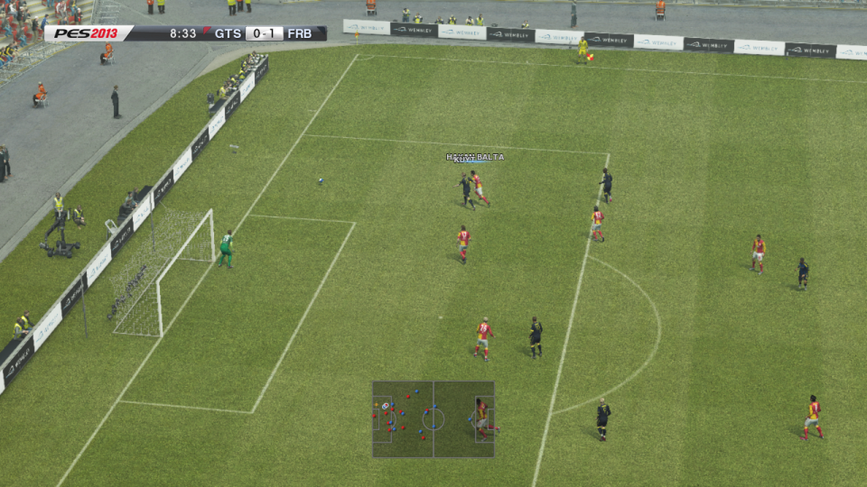
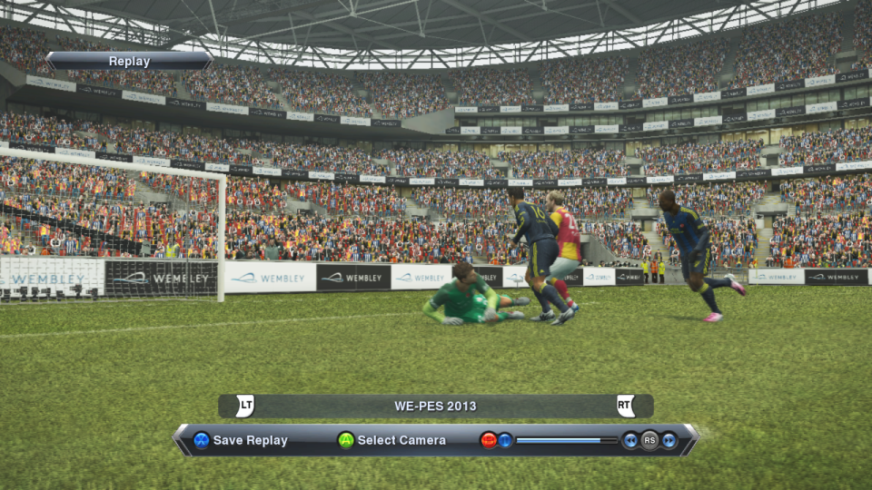
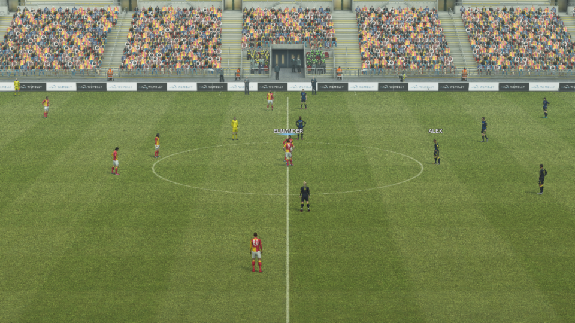

<h1 align="center">PES13Recomp</h1>

<p align="center">
  <b>An unofficial native port of Pro Evolution Soccer 2013 (Xbox 360), built by static recompilation, for Windows and iPad.</b>
</p>

> **Experimental branch - not yet tested on an iPad.** Everything here is newer than iPad build #17.
> Builds #28, #30 and #31 have been tested on an **iPhone 11** (see
> [iPhone 11 tests](#iphone-11-tests-builds-28-30-31)), not yet on an iPad - see [What's new on this branch](#whats-new-on-this-branch).
> The code here is now **build #38**: the changes since #31 ([builds #32-#38](#builds-32-38-not-yet-tested-on-a-device))
> are checked on Windows only. The last build tested on the iPad (build #17) is on the `main` branch.

<p align="center">
  
  
  
  
  
  
</p>

<p align="center">
  
  
  
</p>
<p align="center"><sub>Running natively on Windows (Vulkan). Screenshots from the author's own copy of the game.</sub></p>

> [!IMPORTANT]
> **You must own the game.** This repository contains no game code or game files, and no
> builds of the game are distributed. You build it yourself from your own dump of the PES 2013
> Xbox 360 disc (Europe). Pro Evolution Soccer 2013 belongs to Konami; this project is not
> affiliated with Konami or Microsoft.

> [!WARNING]
> **Work in progress.** It is playable on Windows (menus, training, exhibition matches, sound,
> saves), but expect bugs. On iPad (M2) matches are playable at 40-45 fps with touch controls or a
> controller; set pieces, cutscenes and the Game Plan screen still drop to 10-25 fps.


## What's new on this branch

Changes since iPad build #17 (the tested build on `main`). **None of this has been confirmed on an
iPad yet**; everything was checked on Windows (screenshots, Vulkan validation, A/B runs), and
build #28 has been played on an iPhone 11 (results below). Most items can be switched off for
comparison (see the variables in brackets).

### Builds #32-#38 (not yet tested on a device)

Checked on Windows (exhibition matches, screenshots, A/B switches); device results to follow.
- **Blur effects setting** (launch menu, Settings > Performance; default On). Off skips the game's
  blur passes: the glow around stadium lights (including a second pass over the whole scene's
  geometry that only feeds it, ~115 draws per frame), the blurred background behind the pause menu
  and Game Plan (two full-screen 15-tap passes), and a soft full-screen filter.
  (`PES_POST_OFF=glow,pause,soft` or `all`)
- **Lazy clears**: clears of whole EDRAM tiles that are drawn over anyway are no longer drawn,
  also after resolves. (`PES_NO_LAZY_CLEAR=1`)
- **Plain texture fetches**: fetches from unsigned, unbiased textures skip the run-time format
  handling in the translated shaders. (`PES_NO_PLAIN_FETCH=1`)
- **Primitive restart** is always on for strip pipelines (draws the same; Metal cannot turn it
  off). Removes 200+ MoltenVK warnings per session and halves those pipeline variants.
- **Logs**: GPU time per kind of render pass (`[passgpu]`); `[gpu] slow batch` lines say how much
  was pipeline compiling, waiting and the slowest command; the usual long `WAIT_REG_MEM` is
  labelled as the normal vsync wait. iOS/macOS: a crash logger (signal, fault address, backtrace)
  and memory-warning lines.
- The renderer is split into files by area (`runtime/gpu/renderer/`), no behaviour change.

### iPhone 11 tests (builds #28, #30, #31)

Played on an iPhone 11 (Apple A13 GPU, 4 GB RAM) on 2026-11-15, with touch controls and with a
Razer Kishi V2 controller. Build #31 is the code on this branch.

| GPU time per frame, by scene weight | #28 | #30 | #31 |
|---|---|---|---|
| Light (under 150 draws per frame) | 19.8 ms | 16.3 ms | 14.5 ms |
| Normal play (150-350 draws) | 36.4 ms | 37.8 ms | 32.1 ms |
| Heavy (350-550 draws) | 57.3 ms | 52.3 ms | 47.9 ms |
| Heaviest (550+ draws: replays, cutscenes) | 70.9 ms | 70.6 ms | 60.3 ms |

- **#30** (depth kept in passes) halved the render passes per frame (median 43 -> 22) but barely
  changed GPU time: the A13 is limited by the drawing work itself, not by pass switches.
- **#31** (implicit-LOD texture sampling) cut GPU time by about 10-15% in every kind of scene.

Build #28 results:
- **Works:** the launch menu (settings are saved), the controller (touch controls hide while it is
  connected and come back when it disconnects), matches, menus. No crashes in three play sessions.
- **Fixed on a device:** the pitch's TV-static shimmer in motion is gone (texture mip levels).
- **Free Training after a match** (the hang seen on iPad build #17) loaded normally - no hang.
- **Performance:** GPU-bound. Menus ~60 fps, matches 20-30 fps (~38 ms GPU per frame). Replays,
  set pieces, the pause menu and the Game Plan screen drop to 11-12 fps (64-90 ms GPU per frame;
  the game keeps drawing the whole match behind the blurred pause menu, and some scenes split into
  ~130 one-draw render passes per frame, which tile-based GPUs pay for).
- **FSR 1** costs about 2.1 ms GPU per frame on the A13 - leave upscaling off on older iPhones.
- The phone reaches the "serious" thermal state after 10-15 minutes; frame rates barely changed.
- No crashes or new errors in the #30 and #31 sessions (~30 minutes each).
- Next: less work per texture fetch in the shader translator (format decoding at run time).

**Fixes**
- **Texture mip levels.** Textures were created with a single level and sampled at full resolution
  even far away, so the pitch and other detailed surfaces shimmered like a CRT with no signal while
  the camera moved. The mip levels are now read from the game's memory (packed mip tail included)
  and sampled with the game's mip filter, level range and anisotropic filtering.
  (`PES_NO_MIPS=1`) **Confirmed on an iPhone 11.**

**iPad GPU performance** - the iPad is GPU-bound (the renderer itself needs only a few ms of CPU per
frame), and its tile-based GPU pays for every render pass and every copy between passes:
- Resolve copies that nothing ever samples (shadow-map colour, unused depth copies: about a third
  of the resolves) are skipped, and replayed if a skipped surface is sampled after all.
  (`PES_NO_RESOLVE_SKIP=1`)
- Render passes cover only the area their draws touch instead of the whole render target, and
  passes that begin with a full clear skip loading the old contents.
  (`PES_PASS_FULL=1`, `PES_NO_DISCARD_LOADS=1`)
- Cleared EDRAM tiles are filled inside the next render pass instead of being copied between
  render targets (the game clears through 4x-MSAA aliases of its targets): about 80% fewer tile
  copies and far fewer split passes in matches. (`PES_NO_CLEAR_FILL=1`)
- A draw without depth on the scene target stays in the open render pass (keeping its depth
  attachment, with depth off) instead of starting a new pass - the game alternates depth and
  no-depth draws, so one half of the main scene went from 6 passes to 1. (`PES_NO_DEPTH_KEEP=1`)
- **Texture sampling with an implicit LOD.** Xenia's shader translator turns every pixel-shader
  texture fetch into sampling with explicit gradients, which is slow on Apple GPUs. The same LOD is
  now passed as a bias to normal sampling - about 10-15% less GPU time on an iPhone 11. The changed
  translator file is in `runtime/gpu/xenia_patched/` (the Xenia submodule is unchanged).
  (`PES_GRAD_LOD=1`)
- On Windows, a match measured about 22-25% less GPU time with the pass changes on. The log splits
  GPU time on Apple devices into draws / resolves / uploads / EDRAM transfers / other.
- Restored code that had been lost on this branch (it was in every tested device build): thread
  QoS on Apple, the Metal timestamp pool limit (GPU timing in the log), and draining the GPU queue
  when the app goes to the background.

**Upscaling**
- Optional AMD FidelityFX **FSR 1** (EASU + RCAS) or Snapdragon **SGSR 1** for the final picture,
  instead of plain scaling - sharper text, kits and lines on the iPad screen or a large window.
  The upscaler's output resolution can be set (Screen / 1440p / 1080p / 900p). Its GPU time is in
  the log. (`PES_UPSCALER=fsr|sgsr`, `PES_UPSCALE_HEIGHT=1080`)

**Launch menu** (Windows and iPad/iPhone)
- Opens before the game: a stadium background drawn in code, **Play Game**, **Settings**
  (upscaling, upscaling resolution; on iPad also touch controls and the performance overlay) and
  **About** (build, device and GPU, game files check, credits, disclaimer). Settings are saved in
  `userdata/launcher.ini`. Windows: mouse, keyboard or an Xbox controller; `--no-launcher` skips it.

**iPad**
- Every session writes its own log files, `Documents/logs/pes13 <date> <time>.log` / `.err.log`
  (the newest 10 sessions are kept), so restarting the app no longer overwrites a log.
- When the app goes to the background, the log records what every game thread is doing (helps
  with hangs), and GPU memory allocation failures are logged.
- iPhone installs are allowed. Tested on an iPhone 11 (A13): playable, 20-30 fps in matches
  (see [iPhone 11 tests](#iphone-11-tests-builds-28-30-31)). The game needs enough memory for its 4 GB
  reservation.

## Contents

- [What's new on this branch](#whats-new-on-this-branch)
- [Features](#features)
- [Status](#status)
- [Building and playing on Windows](#building-and-playing-on-windows)
- [iPad](#ipad)
- [Controls](#controls)
- [Files and folders](#files-and-folders)
- [Reporting a problem](#reporting-a-problem)
- [How it works](#how-it-works)
- [Credits](#credits)
- [License](#license)

## Features

| | |
|---|---|
| **60 fps** | Matches run at a locked 60 fps on Windows; set pieces and goal kicks are locked to 30 fps by the game itself |
| **Native code** | All ~67,000 PowerPC functions of the game are translated ahead of time to C++, so there is no emulator and no JIT. iPadOS forbids JIT. |
| **Vulkan renderer** | Renders at the GPU command-processor level, with a model of the Xbox 360's EDRAM. Xenos shaders are translated to SPIR-V on first use and cached. |
| **iPad** | Uses the same renderer, running on Metal through MoltenVK |
| **Aspect ratio** | Keeps the game's 16:9 picture on any window or screen shape (letterbox / pillarbox) |
| **Sound** | XAudio implemented on miniaudio |
| **Saves and profiles** | Profiles, save data, notifications and the Xbox on-screen keyboard (player names) work |
| **Controllers** | Xbox, PlayStation and MFi controllers via SDL / XInput, plus a keyboard; on-screen touch controls on iPad |
| **Performance overlay** | On iPad, live FPS, frame time, memory, thermal state and battery in the letterbox bar below the picture |

## Status

| Milestone | State |
|---|---|
| Recompiled code compiles | ✅ Done |
| Boots on Windows | ✅ Done |
| Graphics | ✅ Menus, training, matches and cutscenes render correctly |
| Menus, input, matches | ✅ Windows: training, exhibition matches, sound, saves (60 fps; set pieces and goal kicks locked to 30 fps by the game) |
| iPad | 🚧 Playable on an M2 iPad Air: menus, matches, sound, touch controls. Matches run at 40-45 fps; set pieces, cutscenes and the Game Plan screen drop to 10-25 fps (performance work in progress) |
| Polish | 📋 Planned: anisotropic filtering, FXAA, resolution scaling ([docs/improvements.md](docs/improvements.md)) |

Open bugs are tracked in [docs/listofbugs.md](docs/listofbugs.md).

## Building and playing on Windows

**Requirements:** Visual Studio 2022 with the **C++ Clang tools** (clang-cl and lld; the recompiled
code needs Clang), CMake ≥ 3.20, Ninja and PowerShell. The Vulkan SDK is optional (validation layers).
You also need a GPU with Vulkan support and about 16 GB of RAM for the build.

1. **Clone** with submodules:

   ```bat
   git clone --recursive https://github.com/xamphy/PES13Recomp.git
   cd PES13Recomp
   ```

2. **Dump your disc.** Make an ISO of your own PES 2013 disc (Europe), then extract it with the
   bundled extract-xiso:

   ```bat
   tools\extract-xiso\artifacts\extract-xiso.exe -d game\files "PES 2013.iso"
   copy game\files\default.xex game\xex\default.xex
   ```

3. **Recompile the game code** into `generated/`. This takes a few minutes.

   ```bat
   tools\build-xenonrecomp.bat
   powershell -ExecutionPolicy Bypass -File tools\recomp.ps1
   ```

4. **Build** the runtime and the recompiled code. The first build takes a while (~430 large files).

   ```bat
   tools\build-runtime.bat          :: -> build\Release\bin\pes13.exe
   ```

5. **Play:**

   ```bat
   build\Release\bin\pes13.exe --run
   ```

The first launch is slower while shaders are translated. After that they are cached in `userdata/`.

## iPad

The iPadOS app is built on macOS, either on a Mac or on a macOS runner in your own **private**
repository. Because it contains code recompiled from the game, the `.ipa` is never published here.
Installing it from a Windows PC with AltStore, and copying the game files, is described in
[docs/IPAD.md](docs/IPAD.md).

The app asks for the `extended-virtual-addressing` and `increased-memory-limit` entitlements. The
Xbox 360 address space is 4 GB, and a match uses about 1 GB.

**On the device** (M2 iPad Air, installed with Sideloadly and a free Apple ID): the 4 GB reservation
succeeds and the game is playable - menus, exhibition matches and sound work.

- **Performance (build #17):** matches run at 50-60 fps. Replays, goal celebrations and cutscenes
  drop to 13-25 fps: they are GPU-bound (33-65 ms of GPU time per frame, ~48 render passes, most of
  them a single post-processing draw). Free Training runs at 30 fps. The iPad also throttles once its
  thermal state reaches "serious" (shown in the overlay). Reducing render passes is the current focus.
- **Performance work done:** the game's main thread and the command processor ask iPadOS for
  performance cores (thread QoS). Per-draw GPU timestamps are off on Apple: Metal samples counters only
  between passes, so each one split a render pass and made matches drop to ~25 fps; only the frame
  start / end are timed now. Asynchronous MoltenVK submits were tried and reverted. A `[passes]` log
  line shows why render passes end and how much they load and store. The status bar is hidden.
  Thermal state and Low Power Mode changes are logged. Untested performance work goes to the
  `ipad-perf` branch first; `main` keeps the best build tested on the iPad.
- **Fixed:** files with capitals in their names (e.g. the main menu background movies) were not
  found on the iPad, whose file system is case-sensitive. Paths now match ignoring case.
- **Touch controls:** a floating left stick, D-pad, A/B/X/Y, shoulders, triggers, Back/Start and
  stick clicks drawn over the picture. They hide while a Bluetooth controller is connected.
- **Performance overlay:** FPS, command-processor time per frame, memory, thermal state and battery,
  in the black bar under the 16:9 picture.
- Switching to another app pauses GPU work (iPadOS does not allow it in the background) and the
  game resumes when you come back.

## Controls

A controller is recommended. On iPad, on-screen touch controls appear when no controller is
connected. Keyboard controls (player 1, Windows and Mac):

| Xbox 360 | Keyboard | | Xbox 360 | Keyboard |
|---|---|---|---|---|
| Left stick | W A S D | | A / B | Space / Esc |
| Right stick | I J K L | | X / Y | C / V |
| D-pad | Arrow keys | | LB / RB | Q / E |
| Start / Back | Enter / Backspace | | LT / RT | Shift / R |

## Files and folders

| Path | What |
|---|---|
| `game/xex/default.xex` | the game executable from your disc |
| `game/files/` | the rest of the disc (`dt*.img`, movies, ...) |
| `generated/` | code recompiled from your `default.xex` (made by `tools\recomp.ps1`, never committed) |
| `userdata/` | saves, profile, shader cache, screenshots and logs (created on first run) |

On iPad the same layout lives in the app's Documents folder (Files → On My iPad → PES 2013).

## Reporting a problem

Open an issue and attach the logs of the run:

- Windows: run `pes13.exe --run > userdata\run.log 2> userdata\run.err.log`.
- iPad: the `logs` folder in the app's Documents folder has one `pes13 <date> <time>.log` / `.err.log`
  pair per session (send the pair of the session with the problem).

A crash prints a `[crash]` line with the guest call stack in the error log. Include what you were
doing, and for graphics bugs add a screenshot. Please don't attach game files.

Debugging options:

| Option | What it does |
|---|---|
| `--diag` | Every 10 s: guest threads with call stacks, GPU state, last command packets |
| `--dump-frame N` | Prints every draw of frame N with its decoded state and shaders |
| `PES_CAPTURE=<s>` | Per-draw capture of a frame at second `<s>` (for rendering bugs) |
| `PES_SHOTS` | Periodic screenshots |
| `PES_INPUT_SCRIPT` | Scripted controller input ([tools/nav/README.md](tools/nav/README.md)) |
| `PES_AUDIO_MUTE=1`, `PES_AUDIO_WAV` | Silent runs / record the audio to a file |

## How it works

The game's PowerPC code is translated ahead of time into C++ and compiled for the target CPU:

| Step | Tool | Output |
|---|---|---|
| Dump the disc | extract-xiso | `game/xex/default.xex`, `game/files/` |
| Find functions and jump tables | XenonAnalyse (patched) | `config/pes13.toml`, switch tables |
| PowerPC → C++ | XenonRecomp (patched) | `generated/ppc_recomp.*.cpp` |
| Run it | `runtime/` | `pes13.exe` / `pes13.app` |

The **runtime** replaces the Xbox 360 underneath the game:

- `runtime/kernel`: xboxkrnl / xam (threads, sync, memory, timing, profiles, saves, keyboard UI)
- `runtime/gpu`: the Xenos command processor (PM4) and the Vulkan renderer (EDRAM tiles,
  resolves, depth copies, Xenia's microcode → SPIR-V shader translator)
- `runtime/audio`: XAudio on miniaudio
- `runtime/input`: controllers and keyboard (SDL, XInput)
- `runtime/fs`: disc and HDD paths mapped to `game/files` and `userdata/`

```
app/ios/        iPadOS app bundle (Info.plist, entitlements)
cmake/          build helpers (Xenia shader translator library)
config/         XenonRecomp config for PES 2013 (function sizes, switch tables)
docs/           plan, bug and improvement lists, iPad guide, Direct3D survey
game/           your game dump goes here (ignored by git)
generated/      recompiled game code, made locally (ignored by git)
runtime/        the replacement Xbox 360 kernel, GPU, audio, input and file system
thirdparty/     SDL, Vulkan headers, volk, miniaudio, Xenia, glslang, fmt
tools/          recompiler forks, build, analysis and navigation scripts, patches
```

The architecture and plan are described in [docs/PLAN.md](docs/PLAN.md).

## Credits

- [XenonRecomp / XenosRecomp](https://github.com/hedge-dev/XenonRecomp) by hedge-dev: the
  recompiler. Patched forks are in `tools/`, and the patches are listed in `tools/patches/`.
- [Xenia](https://github.com/xenia-project/xenia): the Xenos shader translator and much of the GPU
  knowledge (BSD-3-Clause, see `thirdparty/xenia/LICENSE`)
- [SDL](https://github.com/libsdl-org/SDL), [MoltenVK](https://github.com/KhronosGroup/MoltenVK),
  [volk](https://github.com/zeux/volk), [miniaudio](https://github.com/mackron/miniaudio),
  [glslang](https://github.com/KhronosGroup/glslang), [fmt](https://github.com/fmtlib/fmt),
  [extract-xiso](https://github.com/XboxDev/extract-xiso)
- [AMD FidelityFX FSR 1](https://github.com/GPUOpen-Effects/FidelityFX-FSR) (MIT, `thirdparty/fsr1`) and
  [Snapdragon Game Super Resolution 1](https://github.com/SnapdragonStudios/snapdragon-gsr)
  (BSD-3-Clause, `thirdparty/sgsr1`): the upscalers on this branch
- [Unleashed Recompiled](https://github.com/hedge-dev/UnleashedRecomp) and the other projects in
  [awesome-x360-recomps](https://github.com/abduznik/awesome-x360-recomps), for showing the way

## License

The code in this repository is licensed under the [GNU General Public License v3.0](LICENSE).
Third-party components keep their own licenses (see `thirdparty/` and `tools/`).

Pro Evolution Soccer 2013 © Konami Digital Entertainment. This repository contains no game code or
game files.
